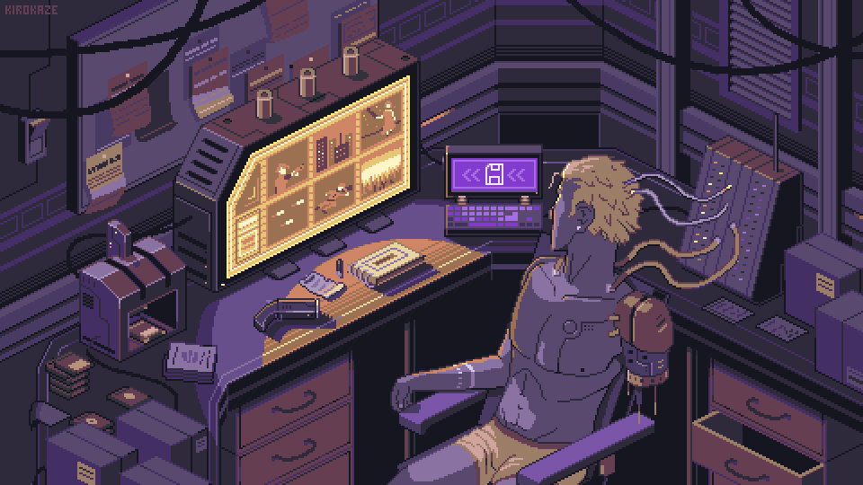

 

---

  

  

  

  

---

<h1 align="center">Gabryell da Silva Gonçalves</h1>

  <strong>Full Stack Developer</strong> | Estudante de Sistemas para Internet no IFRN. 
  Especializado em desenvolvimento web do front-end ao back-end. 
  Curioso, determinado e apaixonado por aprendizado contínuo.

  

---

## 📫 Contato

  
  &nbsp;
  
  &nbsp;
  

---

## 💻 Tecnologias & Habilidades

<table align="center">
  <tr>
    <td align="center" width="100"> React</td>
    <td align="center" width="100"> Python</td>
    <td align="center" width="100"> JavaScript</td>
    <td align="center" width="100"> C++</td>
    <td align="center" width="100"> MySQL</td>
    <td align="center" width="100"> TypeScript</td>
    <td align="center" width="100"> AWS</td>
  </tr>
  <tr>
    <td align="center" width="100"> Django</td>
    <td align="center" width="100"> GitHub</td>
    <td align="center" width="100"> Git</td>
    <td align="center" width="100"> Laravel</td>
    <td align="center" width="100"> HTML5</td>
    <td align="center" width="100"> CSS</td>
    <td align="center" width="100"> Bootstrap</td>
  </tr>
  <tr>
    <td align="center" width="100"> MongoDB</td>
    <td align="center" width="100"> Node.js</td>
    <td align="center" width="100"> PHP</td>
    <td align="center" width="100"> VSCode</td>
    <td align="center" width="100"> SQLite</td>
    <td align="center" width="100"> Java</td>
    <td align="center" width="100"> PostgreSQL</td>
  </tr>
</table>

---

## 📊 Estatísticas do GitHub

  
  &nbsp;
  

---

<h3 align="center">
  <em>"Don't ever let somebody tell you, you can't do something!</em> 
  <strong>You got a dream… You gotta protect it.</strong> 
  <em>People can't do something themselves, they wanna tell you you can't do it.</em> 
  <strong>If you want something, go get it. Period."</strong>
</h3>

  

